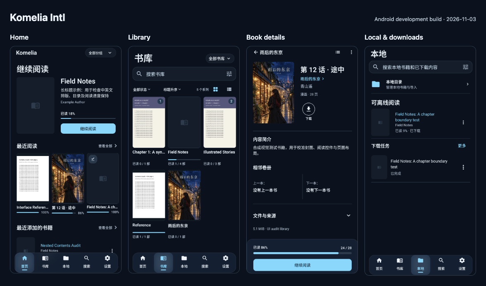
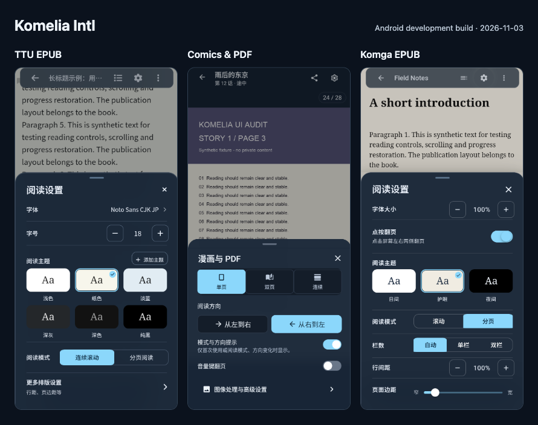
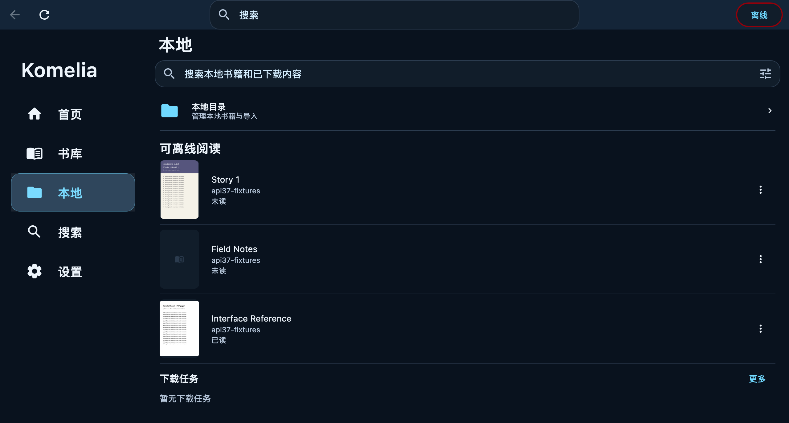

# Komelia Intl

[English](README.md) | [简体中文](README_zh-CN.md)

[](https://github.com/SakuraSM/KomeliaIntl/releases/latest)
[](LICENSE)

Komelia Intl is the `SakuraSM/KomeliaIntl` fork of [Komelia](https://github.com/Snd-R/Komelia), a cross-platform client for a [Komga](https://komga.org/) media server. It adds Simplified Chinese localization, an adaptive interface, reader fixes, and fork-specific release support.

Komga-backed features need a reachable Komga server and account. Android and desktop can also start in local-library mode without a server and index supported books from a folder on the device.

## Core changes in this fork

### Reading interface

Home puts the cover, reading progress, and Continue reading action together. Library and local pages provide persistent search and filters, and book details keep one primary reading action. Wide windows show a book list or grid beside the selected book and retain that selection when resized.

The app supports Classic and Liquid Glass appearances, Light, Dark, and OLED themes, reduced transparency, reduced motion, and keyboard focus. Image, PDF, and EPUB reader controls share the app's appearance. TTU and Komga EPUB keep independent publication themes.

### Automatic remote and LAN switching

You can configure a primary remote URL and an optional LAN URL. When automatic switching is enabled, Komelia probes the LAN address and uses it when reachable. Otherwise, it keeps the primary remote address. Android checks again when network connectivity changes.

### Local downloads and offline reading

On supported native targets, you can download books, browse the local cache by series, book, or media type, and remove cached items. Downloaded CBZ, CBR, PDF, and EPUB files remain available in Offline mode.

### Local folder libraries

Android and desktop can add a local folder without signing in to Komga. Komelia indexes supported files recursively, groups books by their parent folder, keeps the folder permission across restarts, and detects additions and removals on startup or during the scheduled scan. Both support CBZ/ZIP, CBR/RAR, EPUB, and PDF. Source files stay in place and are never deleted by removing a local library from Komelia. Browser/Wasm builds do not provide persistent folder libraries.

On Windows and Linux, PDF pages containing JPEG 2000 images require a compatible ImageIO decoder, which is not bundled. macOS uses the system PDF renderer.

## Other changes

- Adds in-app language selection for System, English, and Simplified Chinese. The Compose app, Android system pages, and EPUB controls use the selected language.
- Refines image and EPUB reader controls, page retry, progress dragging, and Back behavior.
- Uses this repository for app updates and shows announcements from both this fork and upstream Komelia.

## What you can do

- Browse libraries, collections, and read lists. Search and filter series and books.
- Read CBZ, CBR, PDF, and EPUB files with the built-in image and EPUB readers.
- Edit series and book metadata. Connect to Komf for supported metadata workflows.

## Maintenance

I maintain this repository independently. I track upstream Komelia and aim to ship an iteration about once a week. The schedule may shift based on upstream changes, test results, and available time. Thanks for using Komelia Intl.

## Build targets

The source tree contains these build targets. A GitHub Release can contain only the platforms built for that version, so use its **Assets** list as the source of truth.

The macOS source build includes native image decoding, WebView, and CPU-based ONNX Runtime. Apple Silicon has been exercised locally. Intel native integration tests, DMG packaging, and installed-app startup passed in [CI](https://github.com/SakuraSM/KomeliaIntl/actions/runs/42195533442/job/127817757906). Locally built DMGs use an ad-hoc signature and are not notarized.

| Target | Gradle task | Typical package |
|---|---|---|
| Android | `androidRelease` | APK |
| Windows x86_64 | `desktopMsi` | MSI |
| Linux x86_64 | `desktopDeb` | DEB |
| macOS Apple Silicon | `desktopDmg` | DMG |
| macOS Intel | `desktopDmg` | DMG |
| Desktop on Windows, Linux, or macOS | `desktopJar` | JAR |
| Browser, WebAssembly | `komfWebUI` | Static web files |
| Komf extension for Chrome | `komfExtensionChrome` | ZIP |
| Komf extension for Firefox | `komfExtensionFirefox` | ZIP |

## Download the app

- [Latest Komelia Intl Release](https://github.com/SakuraSM/KomeliaIntl/releases/latest)
- [All Komelia Intl Releases](https://github.com/SakuraSM/KomeliaIntl/releases)

The standalone Android build uses the package ID `io.github.zhengningning.komelia` and this repository's signing certificate. Android cannot update an installation signed by another distributor. If Android reports a signature conflict, uninstall the other build first or keep using the same distribution channel.

The [upstream Releases](https://github.com/Snd-R/Komelia/releases), [Google Play package](https://play.google.com/store/apps/details?id=io.github.snd_r.komelia), [F-Droid package](https://f-droid.org/packages/io.github.snd_r.komelia/), and [AUR package](https://aur.archlinux.org/packages/komelia) contain upstream Komelia, not this fork's changes.

## Interface preview

These captures show the Simplified Chinese UI in the Android development build, using synthetic test books.



Reader settings for TTU EPUB, comics/PDF, and Komga EPUB:



The [18 runtime screenshots](docs/verification/modern-ui-alignment-20261102-assets/screens/) also include light themes and Android wide layouts. See the [verification record](docs/verification/modern-ui-alignment-20261102.md) for build and device coverage.

macOS local library with synthetic test books:



## Build from source

Release workflows use JDK 21 and Node.js 24. The local `.node-version` currently declares Node.js 20; the [Harness scorecard](docs/harness/scorecard.md) records this toolchain split until the repository adopts one declaration. Android and desktop packages also need the platform's native image and WebView libraries. The files under `cmake/` build Linux and Windows dependencies with Docker.

Clone this fork with its submodules:

```shell
git clone --recurse-submodules https://github.com/SakuraSM/KomeliaIntl.git
cd KomeliaIntl
```

If you already cloned the repository, initialize the submodules before building:

```shell
git submodule update --init --recursive
```

Build the EPUB reader resources before packaging an app:

```shell
./gradlew buildEpubReaders
```

Use the root build aliases for common targets:

```shell
./gradlew androidDebug
./gradlew desktopJar
./gradlew komfWebUI
```

On macOS, install the native build dependencies and prepare them before running `desktopJar` or `desktopDmg`. Use a JDK distribution suitable for packaging, such as Temurin 21:

```shell
brew install cmake meson ninja pkgconf glib jpeg-turbo libexif jpeg-xl highway libpng libtiff webp little-cms2 cgif libomp dav1d libde265
scripts/macos/build-native.sh
./gradlew desktopDmg
```

The outputs are under the corresponding module's `build/` directory. For release packaging and native dependency commands, follow [the desktop Release workflow](.github/workflows/release-desktop.yml) and [the engineering harness](docs/harness/README.md).

## Contribute

Read [CONTRIBUTING.md](CONTRIBUTING.md) before opening a pull request. Translation changes also use the [Simplified Chinese contribution guide](docs/i18n/CONTRIBUTING_zh-CN.md) and [glossary](docs/i18n/glossary_zh-CN.md).

Report bugs and request changes in [GitHub Issues](https://github.com/SakuraSM/KomeliaIntl/issues). Do not include credentials, private server addresses, or unredacted library content.

## License and upstream

Komelia Intl is available under the [Apache License 2.0](LICENSE). The project is based on [Snd-R/Komelia](https://github.com/Snd-R/Komelia); upstream and fork changes keep their respective copyright notices.
