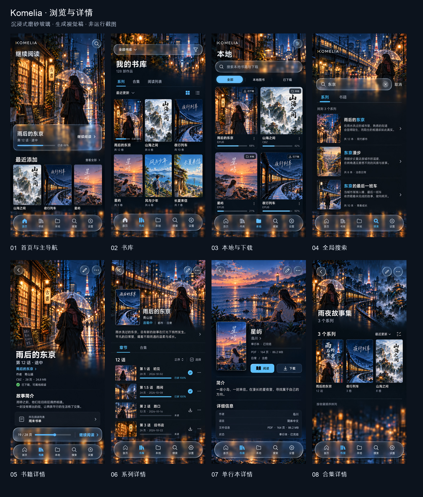
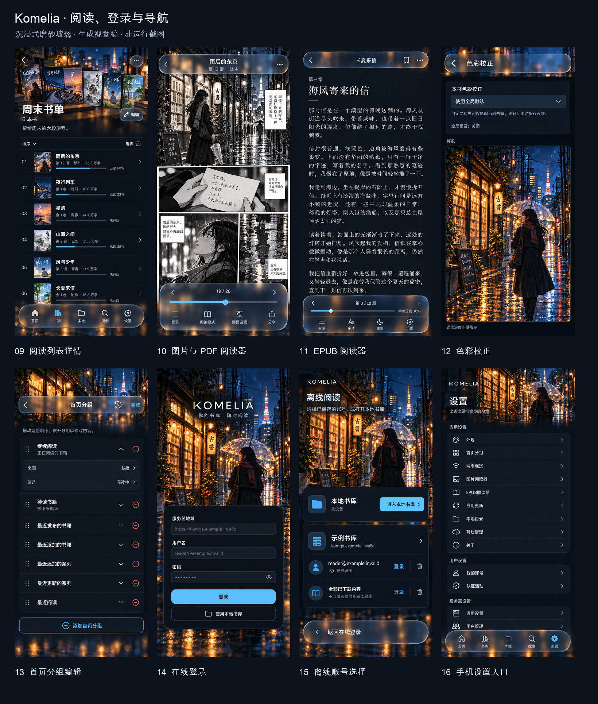
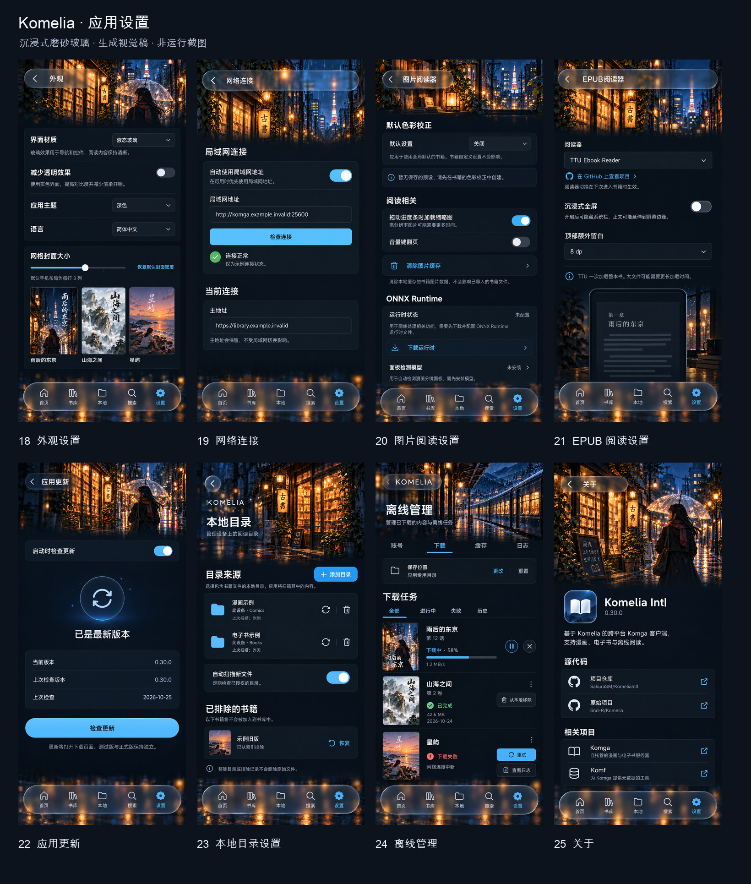
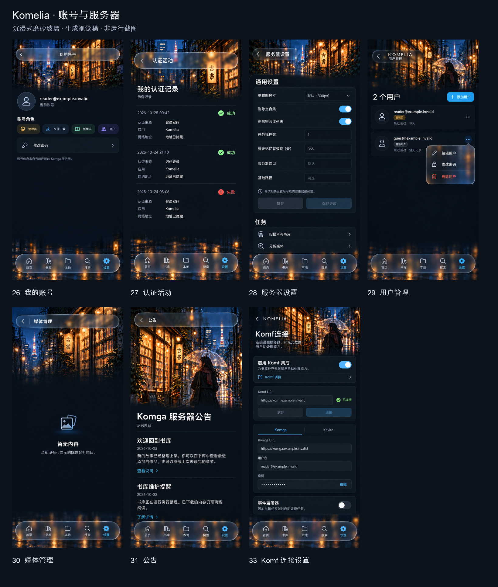
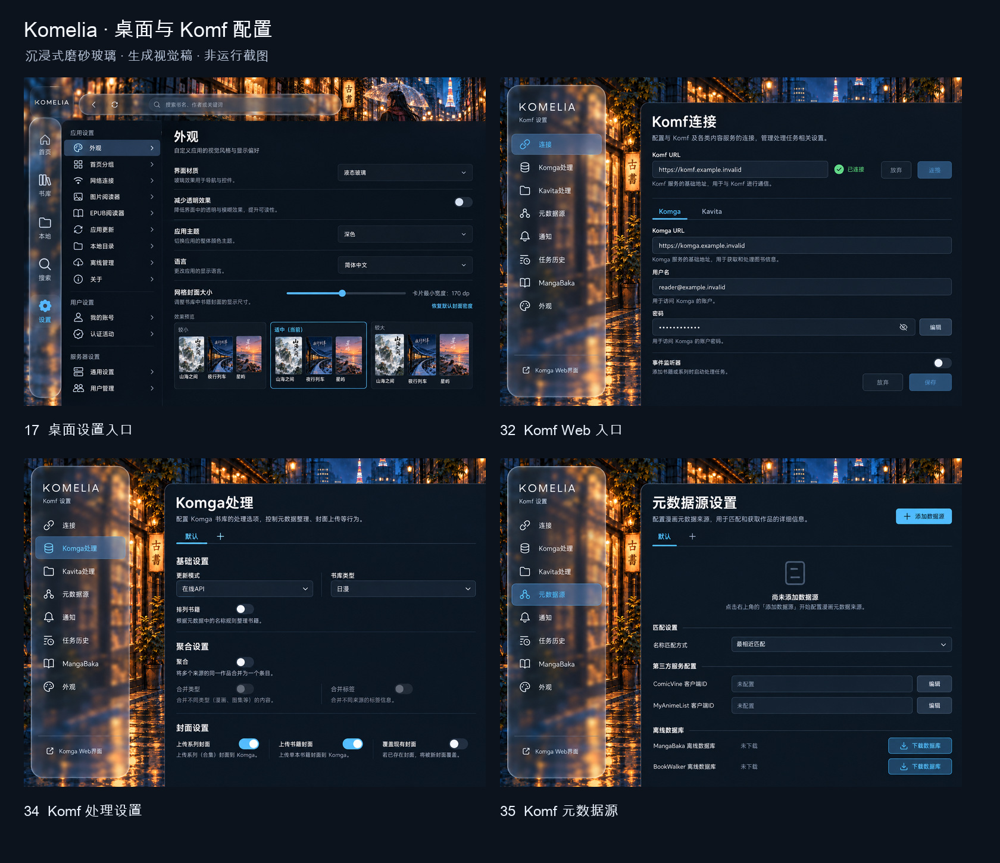
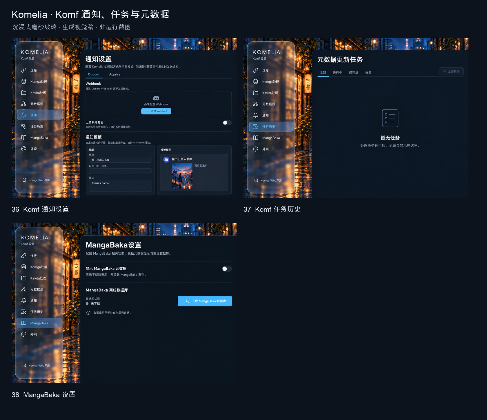

# 沉浸式磨砂玻璃视觉稿

这套方案采用用户选定的第 2 种方向：深色背景、作品大图、明显的磨砂透光与独立的导航层。2026-10-25 完成 38 张页面稿，覆盖当前清单中的 39 个 Screen 入口；首页与主导航共用一张。

本目录保存的是生成设计稿，供后续实现时对照。应用代码尚未按这些图修改，图片不代表功能、性能或设备验收。每张图展示一个代表状态，不表示所有平台、弹层和数据分支都已设计完成。

## 参考入口

- [用户选定的原始方向](selected-direction.png)。首页稿进一步去掉了阅读按钮内部的重复玻璃层。
- [设计规则与实现边界](DESIGN-SYSTEM.md)。
- [页面清单与图片校验值](manifest.json)。
- [完整生成提示词及定向修正记录](generation-record.json)。本轮使用内置 ImageGen。
- [现有页面走查清单](../../verification/liquid-glass-page-audit-20261022.md)。该清单是此前运行证据，本目录是新的视觉目标，二者不可混用。

设计参考 Apple 的 [Materials 指南](https://developer.apple.com/design/human-interface-guidelines/materials)及 [Meet Liquid Glass](https://developer.apple.com/videos/play/wwdc2025/219/)。玻璃主要用于导航和控件；正文、封面与表单保持清晰。

## 总览

### 浏览与详情

### 阅读、登录与导航

### 应用设置

### 账号与服务器

### 桌面与 Komf 配置

### Komf 通知、任务与元数据

## 页面映射

| 编号 | 视觉稿 | 代表平台 | Screen 与代码入口 |
|---|---|---|---|
| 01 | [首页与主导航](screens/01-home.png) | mobile | [MainScreen](../../../komelia-ui/src/commonMain/kotlin/snd/komelia/ui/MainScreen.kt), [HomeScreen](../../../komelia-ui/src/commonMain/kotlin/snd/komelia/ui/home/HomeScreen.kt) |
| 02 | [书库](screens/02-library.png) | mobile | [LibraryScreen](../../../komelia-ui/src/commonMain/kotlin/snd/komelia/ui/library/LibraryScreen.kt) |
| 03 | [本地与下载](screens/03-local.png) | mobile | [LocalContentScreen](../../../komelia-ui/src/commonMain/kotlin/snd/komelia/ui/local/LocalContentScreen.kt) |
| 04 | [全局搜索](screens/04-search.png) | mobile | [SearchScreen](../../../komelia-ui/src/commonMain/kotlin/snd/komelia/ui/search/SearchScreen.kt) |
| 05 | [书籍详情](screens/05-book.png) | mobile | [BookScreen](../../../komelia-ui/src/commonMain/kotlin/snd/komelia/ui/book/BookScreen.kt) |
| 06 | [系列详情](screens/06-series.png) | mobile | [SeriesScreen](../../../komelia-ui/src/commonMain/kotlin/snd/komelia/ui/series/SeriesScreen.kt) |
| 07 | [单行本详情](screens/07-oneshot.png) | mobile | [OneshotScreen](../../../komelia-ui/src/commonMain/kotlin/snd/komelia/ui/oneshot/OneshotScreen.kt) |
| 08 | [合集详情](screens/08-collection.png) | mobile | [CollectionScreen](../../../komelia-ui/src/commonMain/kotlin/snd/komelia/ui/collection/CollectionScreen.kt) |
| 09 | [阅读列表详情](screens/09-readlist.png) | mobile | [ReadListScreen](../../../komelia-ui/src/commonMain/kotlin/snd/komelia/ui/readlist/ReadListScreen.kt) |
| 10 | [图片与 PDF 阅读器](screens/10-image-reader.png) | mobile | [ImageReaderScreen](../../../komelia-ui/src/commonMain/kotlin/snd/komelia/ui/reader/ImageReaderScreen.kt) |
| 11 | [EPUB 阅读器](screens/11-epub-reader.png) | mobile | [EpubScreen](../../../komelia-ui/src/commonMain/kotlin/snd/komelia/ui/reader/EpubScreen.kt) |
| 12 | [色彩校正](screens/12-color-correction.png) | mobile | [ColorCorrectionScreen](../../../komelia-ui/src/commonMain/kotlin/snd/komelia/ui/color/view/ColorCorrectionScreen.kt) |
| 13 | [首页分组编辑](screens/13-home-groups.png) | mobile | [FilterEditScreen](../../../komelia-ui/src/commonMain/kotlin/snd/komelia/ui/home/edit/FilterEditScreen.kt) |
| 14 | [在线登录](screens/14-login.png) | mobile | [LoginScreen](../../../komelia-ui/src/commonMain/kotlin/snd/komelia/ui/login/LoginScreen.kt) |
| 15 | [离线账号选择](screens/15-offline-login.png) | mobile | [OfflineLoginScreen](../../../komelia-ui/src/commonMain/kotlin/snd/komelia/ui/login/offline/OfflineLoginScreen.kt) |
| 16 | [手机设置入口](screens/16-mobile-settings.png) | mobile | [MobileSettingsScreen](../../../komelia-ui/src/commonMain/kotlin/snd/komelia/ui/settings/MobileSettingsScreen.kt) |
| 17 | [桌面设置入口](screens/17-desktop-settings.png) | desktop | [DesktopSettingsScreen](../../../komelia-ui/src/commonMain/kotlin/snd/komelia/ui/settings/DesktopSettingsScreen.kt) |
| 18 | [外观设置](screens/18-appearance.png) | mobile | [AppSettingsScreen](../../../komelia-ui/src/commonMain/kotlin/snd/komelia/ui/settings/appearance/AppSettingsScreen.kt) |
| 19 | [网络连接](screens/19-network.png) | mobile | [NetworkSettingsScreen](../../../komelia-ui/src/commonMain/kotlin/snd/komelia/ui/settings/network/NetworkSettingsScreen.kt) |
| 20 | [图片阅读设置](screens/20-image-reader-settings.png) | mobile | [ImageReaderSettingsScreen](../../../komelia-ui/src/commonMain/kotlin/snd/komelia/ui/settings/imagereader/ImageReaderSettingsScreen.kt) |
| 21 | [EPUB 阅读设置](screens/21-epub-settings.png) | mobile | [EpubReaderSettingsScreen](../../../komelia-ui/src/commonMain/kotlin/snd/komelia/ui/settings/epub/EpubReaderSettingsScreen.kt) |
| 22 | [应用更新](screens/22-updates.png) | mobile | [AppUpdatesScreen](../../../komelia-ui/src/commonMain/kotlin/snd/komelia/ui/settings/updates/AppUpdatesScreen.kt) |
| 23 | [本地目录设置](screens/23-local-folders.png) | mobile | [LocalLibrarySettingsScreen](../../../komelia-ui/src/commonMain/kotlin/snd/komelia/ui/settings/local/LocalLibrarySettingsScreen.kt) |
| 24 | [离线管理](screens/24-offline-management.png) | mobile | [OfflineSettingsScreen](../../../komelia-ui/src/commonMain/kotlin/snd/komelia/ui/settings/offline/OfflineSettingsScreen.kt) |
| 25 | [关于](screens/25-about.png) | mobile | [AboutSettingsScreen](../../../komelia-ui/src/commonMain/kotlin/snd/komelia/ui/settings/about/AboutSettingsScreen.kt) |
| 26 | [我的账号](screens/26-account.png) | mobile | [AccountSettingsScreen](../../../komelia-ui/src/commonMain/kotlin/snd/komelia/ui/settings/account/AccountSettingsScreen.kt) |
| 27 | [认证活动](screens/27-authentication.png) | mobile | [AuthenticationActivityScreen](../../../komelia-ui/src/commonMain/kotlin/snd/komelia/ui/settings/authactivity/AuthenticationActivityScreen.kt) |
| 28 | [服务器设置](screens/28-server.png) | mobile | [ServerSettingsScreen](../../../komelia-ui/src/commonMain/kotlin/snd/komelia/ui/settings/server/ServerSettingsScreen.kt) |
| 29 | [用户管理](screens/29-users.png) | mobile | [UsersScreen](../../../komelia-ui/src/commonMain/kotlin/snd/komelia/ui/settings/users/UsersScreen.kt) |
| 30 | [媒体管理](screens/30-media.png) | mobile | [MediaAnalysisScreen](../../../komelia-ui/src/commonMain/kotlin/snd/komelia/ui/settings/analysis/MediaAnalysisScreen.kt) |
| 31 | [公告](screens/31-announcements.png) | mobile | [AnnouncementsScreen](../../../komelia-ui/src/commonMain/kotlin/snd/komelia/ui/settings/announcements/AnnouncementsScreen.kt) |
| 32 | [Komf Web 入口](screens/32-komf-web.png) | web | [KomfMainScreen](../../../komelia-ui/src/commonMain/kotlin/snd/komelia/ui/komf/KomfMainScreen.kt) |
| 33 | [Komf 连接设置](screens/33-komf-connection.png) | mobile | [KomfSettingsScreen](../../../komelia-ui/src/commonMain/kotlin/snd/komelia/ui/settings/komf/general/KomfSettingsScreen.kt) |
| 34 | [Komf 处理设置](screens/34-komf-processing.png) | web | [KomfProcessingSettingsScreen](../../../komelia-ui/src/commonMain/kotlin/snd/komelia/ui/settings/komf/processing/KomfProcessingSettingsScreen.kt) |
| 35 | [Komf 元数据源](screens/35-komf-providers.png) | web | [KomfProvidersSettingsScreen](../../../komelia-ui/src/commonMain/kotlin/snd/komelia/ui/settings/komf/providers/KomfProvidersSettingsScreen.kt) |
| 36 | [Komf 通知设置](screens/36-komf-notifications.png) | web | [KomfNotificationSettingsScreen](../../../komelia-ui/src/commonMain/kotlin/snd/komelia/ui/settings/komf/notifications/KomfNotificationSettingsScreen.kt) |
| 37 | [Komf 任务历史](screens/37-komf-jobs.png) | web | [KomfJobsScreen](../../../komelia-ui/src/commonMain/kotlin/snd/komelia/ui/settings/komf/jobs/KomfJobsScreen.kt) |
| 38 | [MangaBaka 设置](screens/38-komf-mangabaka.png) | web | [KomfMangaBakaSettingsScreen](../../../komelia-ui/src/commonMain/kotlin/snd/komelia/ui/settings/komf/mangabaka/KomfMangaBakaSettingsScreen.kt) |

## 检查范围

已逐张查看生成结果，并定向修正合集菜单缺失图标、EPUB 章节编号不一致及公告页多出的搜索控件。已核对 38 张原图、39 个 Screen 映射、原图完整性与本地链接。

后续实现仍需验证动态模糊与折射、滚动帧率、透明度回退、对比度、触控和键盘焦点、安全区、长文本及英文布局。静态生成图不能证明这些行为。图片中的封面、背景、角色、文件大小、进度和示例公告均为构图数据。
