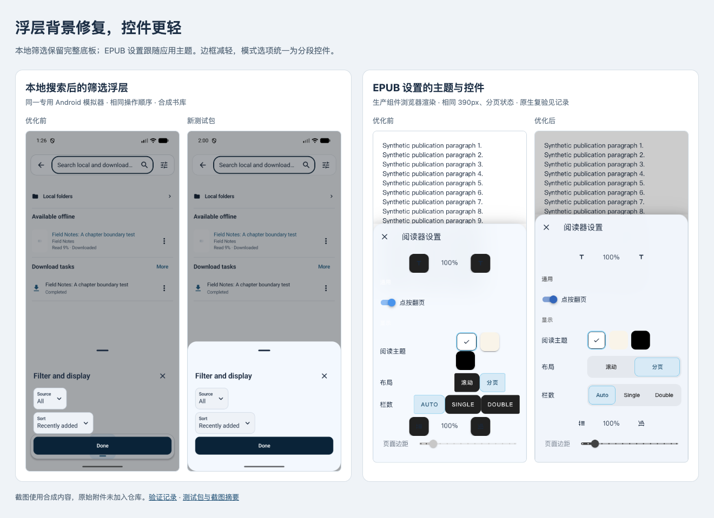

# 浮层背景与阅读设置验证

2026-10-30。修复本地搜索后筛选浮层背景消失、Komga EPUB 浅色设置里的黑底控件与低对比度标题。整体减轻边框，模式选项采用统一分段控件，大字号时按内容换行。

[前后对照](assets/immersive-surfaces-20261030/comparison.html) · [包与截图摘要](assets/immersive-surfaces-20261030/manifest.json)



## 两处问题与修复

| 场景 | 原因与改动 | 复现和验证 |
|---|---|---|
| 本地搜索后打开筛选 | 搜索编辑暂停背景采样，新浮层没有可用帧；原生容器又设为透明，页面直接露到控件下面。保留一个跟随主题的底板，有背景帧时再叠加玻璃效果。 | 旧 APK 在合成书库复现相同透穿。回归测试在首帧前暂停采样，旧版取到下层页面颜色，新版保持可读底色。新包重复相同操作顺序通过。 |
| Komga EPUB 阅读设置 | 外层 CSS 已切换浅色，内部 Vuetify 控件仍继承深色。设置组件显式接收应用主题，按钮、小标题与面板一致；表单浮层提高底色覆盖率。 | 真实设置模板旧版出现深色文字与 `rgb(33, 33, 33)` 按钮背景。新组件在 Classic、Glass、减少透明效果下的浅色、深色、OLED 共 9 组调色组合通过对比度检查，普通文字不低于 4.5:1。原生 WebView 另行打开设置复核。 |

共享玻璃边框从 18% 降到 10%，网页端边框同步减轻。设置面板遮罩与控件层次统一，阅读主题的白、纸色、黑色样本仍按真实颜色显示。浏览器复核还发现 360px、130% 字号时英文选项越过按钮边界，已增加文字边界回归并改为自动换行。

`ReaderSettingsSheet.vue` 只负责呈现和模型事件，原有参数应用、保存与阅读进度仍由 `EpubReader` 处理。列数和方向的类型声明改为实际的字符串类型，持久化值没有变化。正文和出版物样式没有纳入这次改动。

## 最终包复验

原生复验使用专用 Android 模拟器，实际读取系统版本为 API 37。尺寸 1080 × 2400、密度 420、默认字号；浏览器组件图为 390 × 844 CSS px，大字号补充图为 360 × 800。两类图片分别标注。用户原始附件没有加入仓库，截图仅包含合成书库与测试文本。

- 本地搜索输入框取得焦点，返回收起键盘，再打开筛选。浮层标题、表单、完成按钮及底部区域均有完整底色；完成可关闭浮层。
- Komga 原生 WebView 设置不再出现黑底深色图标，通用与显示标题可读。字号能从 100% 调到 110% 并恢复，关闭设置后能退出阅读器。
- 另一种 EPUB 实现的设置面板重新打开，六个主题与字体入口仍可见；共享浮层底色没有覆盖阅读主题样本。
- 大字号下英文标签仍落在各自按钮范围内，滑动可以到达页面边距控件。浏览器覆盖字号、行距、阅读主题、模式、列数、点按翻页、页面边距、固定版式方向和 Esc 关闭事件。

[原生 EPUB 设置](assets/immersive-surfaces-20261030/after-native-komga-settings-light.png) · [字号操作](assets/immersive-surfaces-20261030/after-native-komga-font110.png) · [另一种 EPUB 设置](assets/immersive-surfaces-20261030/after-native-ttu-settings-dark.png) · [深色](assets/immersive-surfaces-20261030/after-komga-settings-dark.png) · [OLED](assets/immersive-surfaces-20261030/after-komga-settings-oled.png) · [360px 大字号](assets/immersive-surfaces-20261030/after-settings-360-font130.png)

## 检查结果与边界

| 检查 | 结果 |
|---|---|
| 核心自动回归及 `:komelia-ui:allTests` | 568 项，0 失败、0 跳过。完整记录在本工作区 `build/verification/immersive-surfaces-20261030/final-core-record.json`。人工案例仍 pending，整套回归验收未完成。 |
| Komga EPUB `npm test` | 28 项通过，含新增生产设置组件检查。 |
| Komga EPUB `npm run build` | Vue 类型检查及构建通过。 |
| TTU `npm run check`、`npm run test:browser` | 类型检查 0 error、0 warning，6 项浏览器检查通过。 |
| `./gradlew buildEpubReaders` | 两个 EPUB 构建与嵌入 HTML 同步通过。 |
| `./gradlew androidDebug desktopJar komfWebUI` | 三端构建通过。最后一次构建包含大字号修复。 |
| Harness、差异空白、冲突标记、资料链接与摘要 | 通过。 |
| DFA 通用 ESLint 辅助检查 | 受阻。仓库没有辅助脚本要求的 ESLint，未为此新增工具链；项目自身 Vue、Svelte、TypeScript 检查已执行。 |

两处背景问题和大字号文字越界都有先失败后通过的回归证据。

目前没有连接用户真机。真机、TalkBack、性能和完整阅读进度矩阵仍待验；桌面与 Wasm 本轮完成构建及相关自动检查，没有据此宣称业务验收通过。

## 测试包与工作区

测试包 `Komelia-Test-immersive-surfaces-20261030.apk`，包名 `io.github.zhengningning.komelia.debug`，版本 `0.31.1-debug`。实际中英文标签与 APK v2 签名已核对，覆盖安装保留应用数据。安装包与交付文件摘要一致。

```text
a845bcbda259ccc3b95efc866c3a305ff6d8636449964b5a5f52788865b7a5fa
```

原有未提交改动按开始时的摘要保留，接口、数据库、存储值和依赖版本没有改变。递归子模块与固定提交一致。复验后恢复深色液态玻璃、系统语言、TTU 实现和原有显示参数。未推送、合并或发布。
