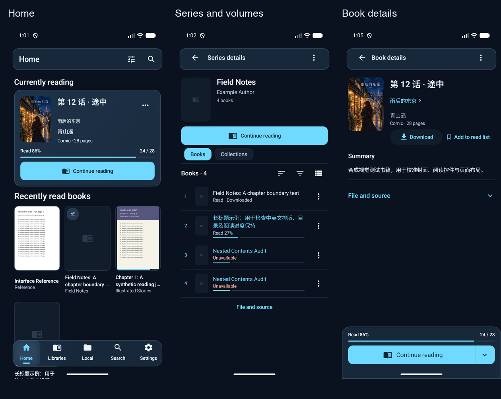

# 阅读体验 UI 对齐验证

2026-10-29 启动，2026-10-30 核对。分支 `feat/reading-experience-v2`，基线 `f02533b6e88909f0c8f5ac49f53a269ea9d372a3`。已按[整套视觉稿](../design/reading-experience-v2-20261029/README.md)接入共享 UI，未合并或发布。下图来自 专用 Android 模拟器和合成书库，不是真机截图。



## 实现范围

- 首页采用小比例完整封面、独立进度和单一续读操作。书库、搜索、本地与卷册复用紧凑行和实际状态，保留已保存的网格/列表偏好。
- 书籍与单册详情隐藏手机主导航，保留一个阅读操作条。目录、简介、下载和书单靠前，文件与管理信息下沉。封面使用 Fit，未知进度不绘制任意百分比。
- 丛书保留排序、筛选、分页和批量入口，显示实际卷号。续读目标独立于当前筛选与页码，跳过缺失的远程副本，缓存副本仍可读。
- 宽屏采用卷册与详情并排，阅读进入独立页面。详情与阅读器使用不同的 Screen key，避免隐藏详情时释放新建的阅读器模型。
- 手机设置按阅读、文件与离线、账号分组。本地页连接真实下载任务，沿用暂停、重试和取消逻辑。
- 图片/PDF 设置优先展示模式、方向、提示和音量键。两种 EPUB 阅读器的设置、目录使用应用材质，正文主题独立。提示偏好与全局设置共用保存逻辑。

玻璃仍为独立外观选项，保留已有默认、主题和阅读偏好。英语与简体中文资源同步。除前一阶段的 V20 提示字段外，没有修改 Komga 协议、数据库结构、阅读模式枚举或 Android 身份。

## 自动检查

原始日志保留在忽略的 `build/verification/reading-experience-ui/`，核心记录在 `build/regression/`。

| 检查 | 实际结果 |
|---|---|
| 核心 UI、core、shared JVM/Wasm 回归 | 563 项，0 失败、0 跳过 |
| SQLite 测试 | 44 项，0 失败、0 跳过 |
| 离线模块 | 57 项通过；1 项因未提供可选原始书籍样本而跳过 |
| Komga EPUB 测试与构建 | 27 项通过，构建通过 |
| TTU 类型检查、浏览器测试与构建 | 0 错误、0 警告；5 项通过；构建通过 |
| Android、桌面 JAR、Wasm、嵌入 EPUB 构建 | 通过 |
| Harness 与执行器回归 | 22 项通过 |
| Harness、差异空白和冲突标记检查 | 通过 |

主要命令：

```sh
node scripts/regression.mjs run core
./gradlew :komelia-domain:offline:allTests :komelia-infra:database:sqlite:allTests androidDebug desktopJar komfWebUI buildEpubReaders --no-configuration-cache
```

两种 EPUB 包另行执行其测试、类型检查和构建命令。`core` 的自动命令成功后仍返回 2，因为完整人工矩阵未完成，不能据此把整个 profile 写为通过。

测试先复现了丛书头部与阅读操作重叠、TTU 设置白底浅字、显式章节入口仍定位在上一章书签边界、返回丛书时续读目标未刷新，以及隐藏嵌套详情时释放阅读器模型的问题，再验证修复。`ReaderHostNavigationTest` 挂载实际 TabNavigator 生命周期边界，不只检查导航列表。Wasm 首次编译的生成资源错误在清理 UI 模块构建产物后消失，随后构建与浏览器测试通过。

## Android 运行检查

最终测试包为 `Komelia-Test-reading-experience-v2-20261030.apk`，`io.github.zhengningning.komelia.debug`，版本 `0.31.1-debug`。默认名称为 Komelia Test，中文为 Komelia 测试版。已检查包内名称、V2 签名，覆盖安装并冷启动，未清除应用数据。

SHA-256：

```text
a1b7c4620e2b6ab65137bfb6d5d742032e6390e3b52e2134e6eaa9bae417ea4b
```

| 场景 | 观察结果 |
|---|---|
| 深色首页、卷册、漫画与 EPUB 详情 | 完整封面、实际状态、单一阅读操作可见，详情没有双底栏 |
| 本地下载 | 合成 EPUB 下载完成后出现在离线列表和真实完成任务中 |
| 搜索与设置 | 查询产生真实系列结果；清空可操作；分组设置和原有入口可达 |
| 中文浅色，360dp、130% 字号 | 长标题详情与卷册行可换行；阅读条、卷号和操作未出现遮挡 |
| Android 840dp 与 1280dp | 卷册与书籍详情并排。1280dp 使用展开侧栏 |
| 1280dp 进入 EPUB 后系统返回 | 修复后回到同一本书的并排详情，保留 27% 状态；修复前曾返回系统桌面 |
| TTU 详情章节入口 | 目标正文与顶栏均显示 The reading journey，普通书签恢复规则保持 |
| 从宽屏缩至 360dp，再返回 | 先保留所选书籍的全宽详情，返回后恢复卷册列表 |

[首页](assets/reading-experience-ui-20261029/home.png) · [卷册](assets/reading-experience-ui-20261029/series.png) · [漫画详情](assets/reading-experience-ui-20261029/comic.png) · [EPUB 详情](assets/reading-experience-ui-20261029/ebook.png) · [本地](assets/reading-experience-ui-20261029/local.png) · [搜索](assets/reading-experience-ui-20261029/search.png) · [设置](assets/reading-experience-ui-20261029/settings.png) · [连续选章](assets/reading-experience-ui-20261029/chapter.png) · [宽屏返回](assets/reading-experience-ui-20261029/wide.png) · [窄屏详情](assets/reading-experience-ui-20261029/narrow-detail.png) · [窄屏列表](assets/reading-experience-ui-20261029/narrow-list.png)

已恢复模拟器原始尺寸、密度、字号、深色主题、系统语言选项和网格偏好。截图中的书名、封面及正文均为合成测试数据。

## 验证边界

Wasm 实施阶段已检查实际页面启动、外观页导航；最终源码另行执行浏览器语义测试，没有把连接失败当作后端联调成功。桌面 JAR 构建通过；Android 的宽屏截图不代替桌面应用窗口验收。

TTU 连续模式的显式章节入口已修复。最终包冷启动后按第 2 章、第 1 章、第 2 章连续进入，正文与顶栏均一致。初始布局测量保持章节定位，用户移动后释放该定位；普通续读仍保留原来的书签恢复逻辑。实际组件回归覆盖深层片段、初始化后的宽高变化、用户滚动后不回跳，以及普通书签恢复。运行截图与最终 APK 的摘要保存在同目录的 manifest.json。Komga 原生章节/片段跳转、两种实现的完整进度恢复与弹层 Back/焦点矩阵仍待验收。前一阶段的提示与阅读位置边界保留在[提示修复记录](reader-mode-hints-20261029.md)，不沿用其旧 APK 作为本次证明。

真机验证按约定保持暂停。TalkBack、物理设备帧率、完整离线原始样本、最终签名发布包升级和全部人工回归均未完成。本轮没有发布、合并、关闭 issue 或修改 Release。
