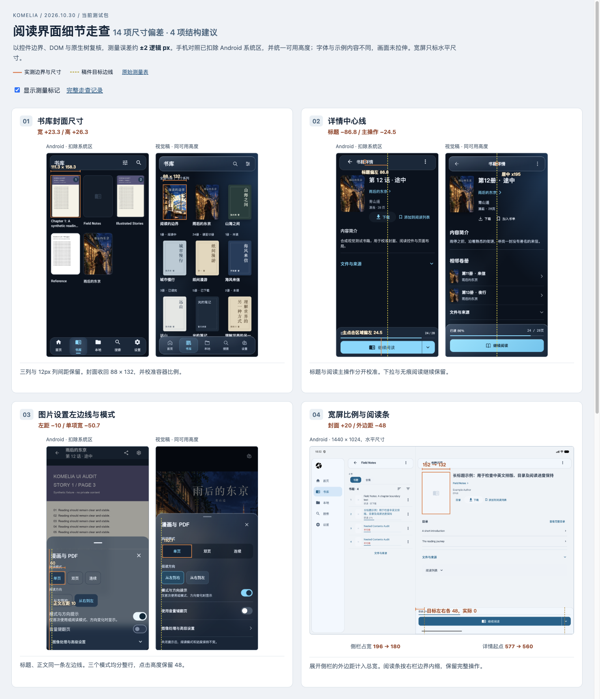

# 阅读界面细节走查

2026-10-30。已重新捕获当前测试包的 16 组页面及 360px、130% 字号补充画面，确认 **14 项可量化偏差、4 项结构建议**。当前界面仍未达到约 2px 的对齐目标。优先调整书库封面、详情顶栏、图片设置和宽屏阅读条。

本次走查对应优化前的测试包。后续调整及新包复测见[布局优化验证](reading-layout-optimization-20261030.md)。

[带测量标记的对照页](assets/reading-layout-audit-20261030/comparison.html) · [原始测量表](assets/reading-layout-audit-20261030/measurements.json) · [截图摘要](assets/reading-layout-audit-20261030/manifest.json)



## 测量口径

- 基准为已确认的[视觉稿与 CSS](../design/reading-experience-v2-20261029/README.md)，实际画面来自 专用 Android 模拟器和合成书库。本次仅增加走查资料，没有修改应用源码。
- 手机统一为 390 × 844 逻辑尺寸、默认字号。Android 运行 PNG 为 1170 × 2532，1 逻辑 px 对应 3 物理像素。参考渲染按 CSS 像素导出，并用 DOM 复核尺寸，控件边界和可见间距的测量误差约 ±2 逻辑 px。原生树、截图像素边界、CSS DOM 和源代码共同核对。字体墨迹不作为跨平台逐像素相等的要求。
- 手机系统顶部为 139 物理像素，底部为 72。对照页裁掉这两块系统区，参考页另以 390 × 774 渲染，剩余高度误差为 0.33px。未拉伸截图。宽屏只比较水平尺寸，未沿用手机的安全区数值。
- 示例书籍、作者、章节和可用能力不同。真实书籍数量、缺失简介、只有一册时不显示相邻卷册、已下载时不显示下载按钮，以及少章节时浮层变矮，均不计布局缺陷。玻璃采样颜色随背景变化，不使用整图颜色差分代替尺寸测量。

## 已确认的尺寸与对齐偏差

所有尺寸为逻辑 px。差值为实测减目标。

| 编号 | 页面或组件 | 测量项目 | 稿件目标 | 实测 | 差值 |
|---|---|---|---|---|---|
| M01 | 共享顶栏 | 安全区后的顶栏上外边距 | 12 | 8 | −4 |
| M02 | 详情顶栏 | 书籍详情标题墨迹中心 x | 195 | 108.2 | −86.8 |
| M03 | 书库封面 | 封面容器宽 × 高 | 88 × 132 | 111.3 × 158.3 | +23.3 × +26.3 |
| M04 | 书库标题 | 同一排单行相对双行标题的顶部差 | 0 | 9 | +9 |
| M05 | 丛书头部 | 合集切换层额外高度 | 0 | 49 | +49 |
| M06 | 漫画详情 | 简介标题盒到正文盒的间距 | 8 | 16 | +8 |
| M07 | 阅读主操作 | 主点击区域中线 x | 195 | 170.5 | −24.5 |
| M08 | 图片设置 | 正文左边距 | 20 | 10 | −10 |
| M09 | 图片模式 | 三项模式的单项宽度 | 110.7 | 60 | −50.7 |
| M10 | 平板侧栏 | 导航侧栏整体占宽 | 80 | 96 | +16 |
| M11 | 展开侧栏 | 1440px 导航侧栏整体占宽 | 180 | 196 | +16 |
| M12 | 宽屏封面 | 1440px 详情封面宽 × 高 | 132 × 198 | 152 × 228 | +20 × +30 |
| M13 | 宽屏阅读条 | 相对右详情栏的水平外边距 | 平板 24；宽屏 48 | 0；0 | −24；−48 |
| M14 | 首页分组标题 | 最近阅读分组标题的字体尺寸 | 18 | 22 | +4 |

其中 M02 使用同一句“书籍详情”的墨迹中心。原生文字亮色像素边界为 x231–418，中心换算为 108.2；稿件标题在 x195 居中。M04 在同一排比较标题，排除了整页位置与系统字体差异。封面数字均指容器，图片继续使用 Fit。

## 调整顺序与入口

1. 先处理 M03、M04、M05、M12、M13，统一书库密度、卷册首屏空间和宽屏比例。合集入口需要保留，可并入现有工具区。
2. 再处理 M02、M07、M08、M09，统一详情中心线、阅读主操作和图片设置的左边线。下拉与所有阅读模式继续保留。
3. 最后处理 M01、M06、M10、M11、M14，并复核大字号。不要用全局字体或间距修改带动无关页面。

| 编号 | 建议 | 代码入口 |
|---|---|---|
| M01 | 上外边距统一为 12；56px 顶栏高度保持。 | [KomeliaTopBarSurface.kt](../../komelia-ui/src/commonMain/kotlin/snd/komelia/ui/common/components/KomeliaTopBarSurface.kt#L57) |
| M02 | 详情标题独立居中。返回和更多点击盒起点分别为 28、314，稿件为 17、325，各向内偏 11px。 | [BookScreenContent.kt](../../komelia-ui/src/commonMain/kotlin/snd/komelia/ui/book/BookScreenContent.kt#L174) |
| M03 | 保持三列与 12px 列间距，在列中居中放置 88 × 132 封面。当前容器比例为 0.703，需同步校准到 2:3，继续使用 Fit。 | [ItemCard.kt](../../komelia-ui/src/commonMain/kotlin/snd/komelia/ui/common/cards/ItemCard.kt#L61) |
| M04 | 保留固定标题区和两行空间，把文本改为顶部对齐。 | [ItemCard.kt](../../komelia-ui/src/commonMain/kotlin/snd/komelia/ui/common/cards/ItemCard.kt#L177) |
| M05 | 把合集入口并入已有工具区或更多菜单。保留合集能力和原有语义。 | [SeriesContent.kt](../../komelia-ui/src/commonMain/kotlin/snd/komelia/ui/series/view/SeriesContent.kt#L640) |
| M06 | 简介组成一个内部间距 8px 的分组，组间仍用 16px。 | [BookScreenContent.kt](../../komelia-ui/src/commonMain/kotlin/snd/komelia/ui/book/BookScreenContent.kt#L131) |
| M07 | 单独安排下拉入口，主阅读图文按整条中线对齐。保留无痕阅读。正文容器下留白为 14，稿件约 20，另差 −6。 | [BookReadButton.kt](../../komelia-ui/src/commonMain/kotlin/snd/komelia/ui/common/BookReadButton.kt#L82) |
| M08 | 正文与标题统一到 20px。当前标题起点 16，正文起点 10，相差 6px。CSS 的 1px 边框使实际参考起点为 21，不计额外一项。 | [BottomSheetSettingsOverlay.kt](../../komelia-ui/src/commonMain/kotlin/snd/komelia/ui/reader/image/settings/BottomSheetSettingsOverlay.kt#L181) |
| M09 | 三项均分可用宽度，保持 48px 高和当前方向设置。存在第四种模式时自适应排列。 | [CompactReaderModes.kt](../../komelia-ui/src/commonMain/kotlin/snd/komelia/ui/reader/image/settings/CompactReaderModes.kt#L33) |
| M10 | 把外边距计入总宽。当前是原生 80px 栏加两侧各 8px。 | [MainScreen.kt](../../komelia-ui/src/commonMain/kotlin/snd/komelia/ui/MainScreen.kt#L505) |
| M11 | 整体占宽限制为 180。卷册栏的 380px 已一致；右详情从 x577 开始，稿件 x560，含 1px 分割线共偏 17px。 | [MainScreen.kt](../../komelia-ui/src/commonMain/kotlin/snd/komelia/ui/MainScreen.kt#L509) |
| M12 | 宽屏封面收敛至 132 × 198。834px 的 112 × 168 已与稿件一致。 | [Layout.kt](../../komelia-ui/src/commonMain/kotlin/snd/komelia/ui/Layout.kt#L119) |
| M13 | 平板左右各 24、宽屏左右各 48，采用独立圆角浮条。手机的贴底形式保持。 | [BookScreenContent.kt](../../komelia-ui/src/commonMain/kotlin/snd/komelia/ui/book/BookScreenContent.kt#L119) |
| M14 | 最近阅读使用 18px 局部分组标题，避免套用 headlineSmall。正在阅读目前为 20px，与目标差 2px，单独保留观察。 | [HomeContent.kt](../../komelia-ui/src/commonMain/kotlin/snd/komelia/ui/home/HomeContent.kt#L377) |

## 需要重排的四处结构

以下是已观察到的状态与调整建议。控件数量受书籍状态影响，不把它们都换算成固定位置误差。

| 编号 | 实际状态 | 建议 |
|---|---|---|
| S01 · 长标题详情次操作 | 390px 时目录、下载在第一行，书单在第二行，操作区为两行 48px。 | 将次操作放在封面与书名下方的通栏，或把书单收进已有更多菜单。130% 字号允许再换行，避免靠缩小字体处理。 |
| S02 · 本地目录入口 | 当前为页面上方独立居中按钮。 | 沿用设置页的图标、左对齐标题与右箭头行。稿件与当前文案不同，不计算文字中心差值。 |
| S03 · TTU 字体与主题 | 字体标签和选择器分成两行；6 个主题及新增按钮形成 5+2 排列。 | 字体改为一行摘要入口。保留全部主题与新增能力，用固定格宽排列或把新增作为独立入口。 |
| S04 · 书库筛选层级 | 书库范围、结果类型和数量占据上部，排序与阅读状态使用整行下拉，首屏看不到完成按钮。 | 归并范围、类型和数量。常用排序、阅读状态前置，作者等条件收进高级区，完成按钮固定可达。继续保留即时生效和关闭浮层的原有语义。 |

## 逐页结果与截图

“需调整”表示仍有已量化的布局偏差，“可用”只描述本次看到的布局和入口。

| 步骤 | 页面 | 状态 | 观察结果 | 运行 / 参考 |
|---|---|---|---|---|
| 01 | 首页 | 需微调 | 完整封面与单一续读入口保留。分组标题和底栏选中背景超出稿件尺寸。 | [运行](assets/reading-layout-audit-20261030/01-native.png) / [参考](assets/reading-layout-audit-20261030/01-reference.png) |
| 02 | 书库 | 需调整 | 三列和列间距一致。封面偏大，单行与双行标题的顶部不齐。 | [运行](assets/reading-layout-audit-20261030/02-native.png) / [参考](assets/reading-layout-audit-20261030/02-reference.png) |
| 03 | 丛书卷册 | 需调整 | 卷号、缺失状态和进度可见。合集切换增加一层，压缩首屏卷册空间。 | [运行](assets/reading-layout-audit-20261030/03-native.png) / [参考](assets/reading-layout-audit-20261030/03-reference.png) |
| 04 | 文字书详情 | 需调整 | 完整长标题和目录可见。次操作换成两行，阅读条的主点击区域偏左。 | [运行](assets/reading-layout-audit-20261030/04-native.png) / [参考](assets/reading-layout-audit-20261030/04-reference.png) |
| 05 | 漫画详情 | 需调整 | 完整封面、真实页数和单一阅读条保留。顶栏对齐和简介间距有偏差。 | [运行](assets/reading-layout-audit-20261030/05-native.png) / [参考](assets/reading-layout-audit-20261030/05-reference.png) |
| 06 | 本地与下载 | 可用，需整理 | 离线书籍和已完成任务可见。本地目录采用独立居中按钮，未沿用稿件的行式入口。 | [运行](assets/reading-layout-audit-20261030/06-native.png) / [参考](assets/reading-layout-audit-20261030/06-reference.png) |
| 07 | 搜索入口 | 布局可用，输入待复核 | 空查询的系列浏览、输入框和筛选入口已捕获。ADB 输入未形成可确认的查询状态，不计搜索功能通过。 | [运行](assets/reading-layout-audit-20261030/07-native.png) / [参考](assets/reading-layout-audit-20261030/07-reference.png) |
| 08 | 设置首页 | 基本对齐 | 分组、图标、文字起点和行高接近目标。底部条目需滚动；未把首屏未显示当作丢失。 | [运行](assets/reading-layout-audit-20261030/08-native.png) / [参考](assets/reading-layout-audit-20261030/08-reference.png) |
| 09 | 筛选与显示 | 可用，需整理 | 书库范围、结果类型、数量、排序和阅读状态可达。常用条件仍为多层下拉，更多元数据需纵向滚动。 | [运行](assets/reading-layout-audit-20261030/09-native.png) / [参考](assets/reading-layout-audit-20261030/09-reference.png) |
| 10 | EPUB 目录 | 可用，顶部偏松 | 两章均可见，关闭入口可达。手柄与标题区偏松；少章节的自适应高度不计错误。 | [运行](assets/reading-layout-audit-20261030/10-native.png) / [参考](assets/reading-layout-audit-20261030/10-reference.png) |
| 11 | 文字阅读设置 | 需调整 | TTU 字体、字号、主题和模式均可见。主题及新增按钮为 5+2 排列；字体区占两行。 | [运行](assets/reading-layout-audit-20261030/11-native.png) / [参考](assets/reading-layout-audit-20261030/11-reference.png) |
| 12 | 漫画与 PDF 设置 | 需调整 | 模式、方向和提示开关可见。标题与正文左边线不一致，模式选项没有均分整行。 | [运行](assets/reading-layout-audit-20261030/12-native.png) / [参考](assets/reading-layout-audit-20261030/12-reference.png) |
| 13 | 文字详情浅色 | 同详情偏差 | 长标题与固定阅读条均可见。深色中的顶栏和次操作问题仍存在。 | [运行](assets/reading-layout-audit-20261030/13-native.png) / [参考](assets/reading-layout-audit-20261030/13-reference.png) |
| 14 | 丛书浅色 | 同卷册偏差 | 卷号与状态可辨。仍有额外切换层；颜色变化没有消除布局差异。 | [运行](assets/reading-layout-audit-20261030/14-native.png) / [参考](assets/reading-layout-audit-20261030/14-reference.png) |
| 15 | 834px 平板布局 | 需调整 | 左侧卷册与右侧详情已并排。右栏起点接近稿件，侧栏占宽和底部条外边距有差异。 | [运行](assets/reading-layout-audit-20261030/15-native.png) / [参考](assets/reading-layout-audit-20261030/15-reference.png) |
| 16 | 1440px 宽屏布局 | 需调整 | 展开侧栏与并排详情可见。封面偏大，右栏起点和阅读条外边距超差。此为 Android 宽屏，不代替桌面运行。 | [运行](assets/reading-layout-audit-20261030/16-native.png) / [参考](assets/reading-layout-audit-20261030/16-reference.png) |

[360px、130% 字号补充图](assets/reading-layout-audit-20261030/17-narrow-font130.png)：长标题完整换为四行，目录与阅读条仍可见，次操作依旧占两行。该图属于换行检查，不沿用默认字号的垂直坐标。

## 原生约束与验收边界

- 手机详情封面 92 × 138、丛书封面 76 × 114、续读封面 80 × 120、主内容边距 16，以及已检查的主要点击盒至少 48，均与目标一致或在约 2px 范围内。设置页文字起点 x50 与参考一致，62px 行高也接近参考。
- 原生图片设置的手柄底到标题行盒为 22px，参考为 4px；目录为 38px，参考为 4px。它们来自 48dp 手柄区域和目录额外上内距。标题区确实偏松，但压缩方案需保留手柄点击与拖动能力，不直接把点击盒改成 4px。这两项没有加入 14 项偏差计数。
- 阅读条下拉在原生树中为没有文字或 content description 的 Spinner。TTU 主题按钮的可访问名称为主题 ID。它们是需要读屏复核的标签风险；本次未运行 TalkBack，未宣称通过无障碍验收。
- 搜索页的输入框与空查询结果已捕获。ADB 输入没有形成可确认的查询状态，本次搜索输入验收未完成。书库综合筛选已从书库入口补核，搜索页另有简化浮层。实际元数据条件多于稿件示例，不按控件数量直接计算位置偏差。
- 16 组原生截图均在本轮取得。834px 与 1440px 是 Android 的响应式布局，不能作为桌面 JAR、Wasm、真机帧率、读屏或完整人工回归的通过证据。两种 EPUB 的完整目录与交互矩阵也没有重新验收。

## 包与工作区核对

已安装 APK 与交付 APK 的 SHA-256 一致：

```text
a1b7c4620e2b6ab65137bfb6d5d742032e6390e3b52e2134e6eaa9bae417ea4b
```

走查后已恢复 1080 × 2400、密度 420、字号 1.0、深色磨玻璃、跟随系统语言和网格偏好。原有跟踪文件的 diff 与本次开始时逐字节一致，先前未提交的工作保持原样。未合并、发布或修改 Release。

本轮执行截图检查、几何测量、资料链接检查、Harness 和差异空白检查。应用代码没有变化，不重复计入前一轮测试数量，也不把前一轮结果当作本轮新增运行验收。
