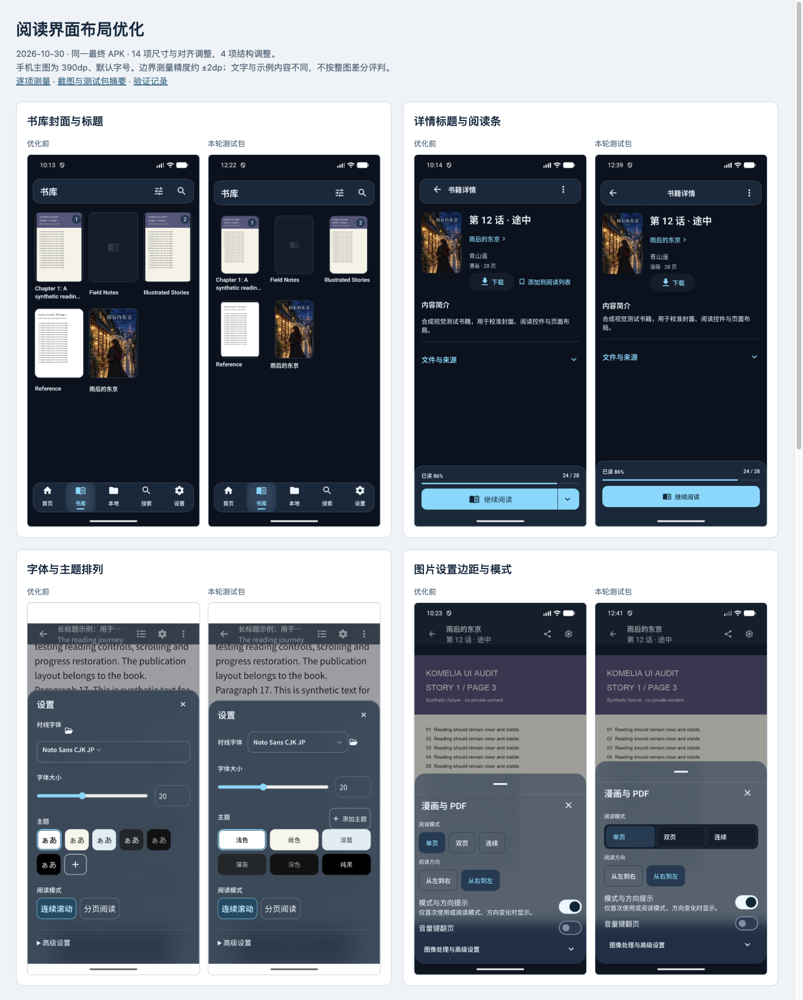

# 阅读界面布局优化验证

2026-10-30。已落实[细节走查](reading-layout-audit-20261030.md)的 14 项尺寸与对齐调整、4 项结构调整，并在新测试包中复核。已测几何偏差收敛到约 2dp 范围内。该结论限于下表列出的控件边界、尺寸和间距，不代表全部画面逐像素一致。

[前后对照页](assets/reading-layout-optimization-20261030/comparison.html) · [逐项测量](assets/reading-layout-optimization-20261030/measurements.json) · [截图与包摘要](assets/reading-layout-optimization-20261030/manifest.json)



## 调整结果

手机主图为 390dp、默认字号、专用 Android 模拟器。每个逻辑 dp 对应 3 个截图物理像素，顶部系统区 139px。几何测量约 ±2dp。字体大小按 sp 记录，Android 文本框和字体墨迹不与浏览器强求逐像素相等。搜索补验在 411.43dp、英文环境完成，单独标注。

| 编号 | 项目 | 优化前 | 本轮结果 | 与目标差值 |
|---|---|---|---|---|
| M01 | 顶栏上外边距 | 8 | 12 | 0 |
| M02 | 详情标题墨迹中心 x | 108.2 | 195.17 | +0.17 |
| M03 | 书库封面宽 × 高 | 111.3 × 158.3 | 88 × 132 | 0 × 0 |
| M04 | 同排单行与双行标题顶部差 | 9 | 0 | 0 |
| M05 | 独立合集切换层高度 | 49 | 0 | 0 |
| M06 | 简介标题到正文间距 | 16 | 8 | 0 |
| M07 | 阅读主点击区域中心 x | 170.5 | 195 | 0 |
| M08 | 图片设置正文左边距 | 10 | 20 | 0 |
| M09 | 三项图片模式的单项宽度 | 60 | 111.33 | +0.63 |
| M10 | 平板侧栏总占宽 | 96 | 80 | 0 |
| M11 | 宽屏侧栏总占宽 | 196 | 180 | 0 |
| M12 | 宽屏详情封面 | 152 × 228 | 132 × 198 | 0 × 0 |
| M13 | 平板、宽屏阅读条左右留白 | 0、0 | 24、48 | 0、0 |
| M14 | 最近阅读分组字号 | 22sp | 18sp | 0sp |

M03 继续使用 Fit，完整封面保持 2:3。M07 的主按钮占满可用宽度，无痕阅读移到既有更多菜单。834dp 的详情封面仍为 112 × 168。1440dp 右详情栏从 x561 开始，参考为 x560，分割线和像素取整合计约 1dp。

| 结构建议 | 本轮结果 | 实际复验 |
|---|---|---|
| S01 · 长标题详情次操作 | 书单移到已有更多菜单，头部保留目录和下载。 | 390dp 单行容纳次操作；360dp、130% 字号时完整长标题、目录与阅读按钮均可见。书单对话框能打开并显示既有书单。 |
| S02 · 本地目录 | 图标、左对齐标题和右箭头组成入口行。 | 离线书籍与已完成下载任务仍可见。 |
| S03 · TTU 字体与主题 | 字体摘要同排；六个主题为三列两排；新增主题单独保留。 | WebView 实际截图确认；字体选取和 Esc 焦点恢复由生产组件浏览器测试覆盖。 |
| S04 · 筛选层级 | 范围和类型同排，数量和每页数量同排，排序与阅读状态前置，高级条件折叠。 | 展开高级条件并滚动后，完成按钮仍在底部，点击能关闭。原有即时生效的状态回调保留。 |

## 功能与适配复验

本轮画面来自同一个最终 APK。页面截图和 APK 的 SHA-256 见摘要文件。只展示合成书库与公开设计素材，没有真实账号或私人书籍内容。

- 合集已从卷册工具栏实际切换，原有 Audit shelf 合集可见，随后恢复书籍视图。
- 详情更多菜单保留阅读、隐身阅读和添加到阅读列表。隐身阅读从第 24 页翻到第 25 页，退出后详情仍为 24 / 28。此验证使用合成漫画，不外推到所有阅读格式。
- 英文搜索输入 Field 后显示 Field Notes；清空后恢复默认结果。此前走查的搜索输入待核项已补验，没有修改搜索逻辑。
- TTU 设置已在 Android WebView 中打开，六个主题均可见，字体与标题中心在同一行。EPUB 原生两章目录及关闭入口已复核。
- 浅色详情和卷册、360dp 与 130% 字号、834dp 和 1440dp 布局均重新捕获。1440dp 阅读后返回同一卷册与详情，再缩到手机宽度，仍能显示当前书籍详情。
- 最终 Wasm 组装输出已在浏览器启动，外观页可切换液态玻璃。预览没有 Komf 后端，配置请求返回 404；这项只证明前端启动和外观操作。桌面本轮完成 JAR 构建，未宣称桌面运行验收。

[无痕阅读翻页](assets/reading-layout-optimization-20261030/12-incognito-advanced.png) · [退出后原进度](assets/reading-layout-optimization-20261030/05-incognito-return.png) · [书单对话框](assets/reading-layout-optimization-20261030/04-readlist-dialog.png) · [筛选滚动后](assets/reading-layout-optimization-20261030/09-filters-scrolled.png) · [大字号](assets/reading-layout-optimization-20261030/17-narrow-font130.png) · [宽屏阅读返回](assets/reading-layout-optimization-20261030/16-wide-reader-return.png) · [缩回手机](assets/reading-layout-optimization-20261030/18-resized-phone-detail.png) · [Wasm 外观](assets/reading-layout-optimization-20261030/wasm-glass-final.png)

## 自动检查与构建

| 命令或检查 | 结果与边界 |
|---|---|
| `node scripts/check-harness.mjs` | 通过，无警告。 |
| `git diff --check` 与冲突标记检查 | 通过。 |
| `node scripts/regression.mjs run core` | 核心自动检查 567 项通过，0 失败、0 跳过；人工案例仍 pending，整个回归验收未完成。最后一次原始记录保存在本工作区 `build/verification/layout-optimization-20261030/final-core-record.json`。 |
| `:komelia-ui:allTests` | 由 core 执行，覆盖 JVM 与 Wasm 浏览器。新增标题顶对齐、居中阅读按钮、固定封面和长筛选关闭入口回归。 |
| TTU `npm run check` | 0 error、0 warning。 |
| TTU `npm run test:browser` | 6 项通过，含六主题等宽、字体选择、Esc 与恢复焦点。 |
| Komga EPUB `npm test` | 27 项通过。 |
| `./gradlew buildEpubReaders` | 两个 EPUB 构建及嵌入 HTML 同步通过。 |
| `./gradlew androidDebug desktopJar` | Android 测试包与桌面 JAR 构建通过。 |
| `./gradlew komfWebUI` | Wasm 构建通过，随后验证组装输出的启动与外观页。 |
| 通用 DFA ESLint 辅助检查 | 受阻。仓库没有该辅助脚本要求的 ESLint，本轮没有为它新增工具链；TTU 自身的 Svelte 与 TypeScript 检查已通过。 |

标题顶部 9dp 错位和 TTU 字体控件分行均已在改动前通过真实组件测试复现，改动后通过。首次筛选测试使用了错误的固定文案，后改用资源文案；该次失败不作为产品缺陷复现证据。顶栏高度与封面上限的既有断言按新目标更新，其余原有回归继续保留。

## 包与工作区

测试包为 `Komelia-Test-layout-polish-20261030.apk`，包名 `io.github.zhengningning.komelia.debug`，版本 `0.31.1-debug`，与正式版并存。实际打包的英文标签为 Komelia Test，中文标签为 Komelia 测试版，APK v2 签名验证通过。覆盖安装后已冷启动，安装包与交付文件的 SHA-256 一致。

```text
f653748fb7e43e02cd59e2a9fd3d4dc1a9bc8af844e4e4885114e8ff69b067e3
```

[包身份核对](assets/reading-layout-optimization-20261030/installed-identity.json) · [实际打包标签](assets/reading-layout-optimization-20261030/apk-badging.txt) · [签名检查](assets/reading-layout-optimization-20261030/apk-signature.txt)

改动位于共享 UI、TTU 设置、对应测试和少量项目地图。没有修改持久化值、迁移、接口契约或依赖版本。原有未提交改动按开始时的摘要核对，未涉及的文件保留。原生依赖已按固定提交递归初始化，`.gitmodules` 与 gitlink 没有变化。未推送、合并或发布。

模拟器已恢复 1080 × 2400、密度 420、字号 1.0、深色液态玻璃、跟随系统语言和网格偏好。真实设备、TalkBack、帧率、两个 EPUB 实现的完整交互矩阵，以及 core 中其余人工案例仍待验。原生目录与图片设置保留手柄区域，没有通过缩小触摸区压缩标题上方间距。
